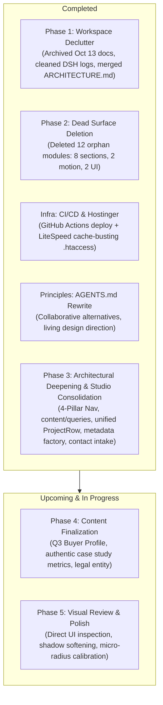

# Clean Code Transformation & Living Roadmap

**Project:** Team NJS Portfolio (`D:\WebDev\portfolio`)  
**Status:** Phases 1, 2, and 3 (Architectural Deepening & 4-Pillar Studio Consolidation) Completed. Phase 4 (Content) & Phase 5 (Visual Polish) Open.  
**Last Updated:** 2026-10-23  

---

## 🎯 Progress Overview

---

## 📋 Transformation Phase Checklist

### ✅ Phase 1: Workspace Declutter & Documentation Consolidation (COMPLETED)
- [x] **1.1 Archive Historical Root Docs:**  
  Moved 5 historical snapshots from October 13 into `docs/archive/historical-20261013/` (`AUDIT_REPORT.md`, `ORCHESTRATOR_HANDOFF.md`, `plan-01-core-skeleton.md`, `SKIPPED_SUBAGENTS.md`, `ORIGINAL_REQUEST.md`).
- [x] **1.2 Clean Session Artifacts & Temporary Files:**  
  Deleted DSH session zip archives and extracted log directories. Archived temporary review artifacts (`architecture-review-20261022-2120.html` and `handoff-team-njs-20261022-2126.md`) into `docs/archive/`.
- [x] **1.3 Consolidate Root Documentation:**  
  Merged `PROJECT.md`, `TECHNICAL_MANUAL.md`, and `GLOSSARY.md` into a single canonical source of truth: [`docs/ARCHITECTURE.md`](ARCHITECTURE.md). Moved test catalog to [`tests/README.md`](../tests/README.md). Removed redundant `GEMINI.md` and `GATE_STATUS.md`.
- [x] **1.4 Minimal Root Directory:**  
  Root now contains only `README.md`, `AGENTS.md`, and essential configuration files (`package.json`, `tsconfig.json`, `next.config.ts`, `tailwind.config.ts`, `eslint.config.mjs`).

---

### ✅ Phase 2: Dead Surface Deletion (COMPLETED)
- [x] **2.1 Delete 8 Orphan Section Components:**  
  Deleted unused legacy sections from `components/sections/`:  
  `TrustBar.tsx`, `StatsStrip.tsx`, `TechStackStrip.tsx`, `Testimonials.tsx`, `ProcessPreview.tsx`, `ServicesOverview.tsx`, `FeaturedProjects.tsx`, `CTABanner.tsx`.
- [x] **2.2 Delete Dead Motion & UI Modules:**  
  - Deleted unwired motion primitives: `components/motion/Parallax.tsx` (KI-010) and `components/motion/ScrollReveal.tsx`.
  - Updated `components/motion/index.ts` to export only `MotionProvider` and `Reveal`.
  - Deleted unused UI wrappers: `components/ui/Badge.tsx` and `components/ui/Card.tsx`.
- [x] **2.3 Resolved Issue Tracking:**  
  Marked `KI-007` (Dead Files) as Resolved in [`docs/KNOWN_ISSUES.md`](KNOWN_ISSUES.md).
- [x] **2.4 Verified Quality Gates:**  
  Full test suite passed cleanly with 0 regressions: 0 TypeScript errors, 0 ESLint warnings, 28 exported routes, and **66/66 E2E tests passing**. Committed in `c53b9e1`.

---

### ✅ Infrastructure & Operational Workflows (COMPLETED)
- [x] **CI Quality Gate:** Added `.github/workflows/ci.yml` to automatically typecheck, lint, build, and test on all pushes and PRs.
- [x] **Automated Hostinger Deployment:** Added `.github/workflows/deploy.yml` to deploy static `out/` via FTPS on push to `main`.
- [x] **Hostinger LiteSpeed Cache-Busting:** Added `public/.htaccess` with:
  - `X-LiteSpeed-Cache-Control: no-cache` on HTML (eliminates stale cache lag on deploy).
  - 1-year immutable caching on hashed `_next/static` assets.
  - Automatic HTTPS enforcement & trailing-slash routing.
  - Branded 404 handler (`ErrorDocument 404 /404.html`).
- [x] **Deployment Documentation:** Authored [`docs/DEPLOYMENT.md`](DEPLOYMENT.md) with FTP credential setup instructions.
- [x] **Agent Compass Overhaul:** Rewrote [`AGENTS.md`](../AGENTS.md) down to 60 actionable lines, embedding **Principle 4 (Collaborative Planning & Competing Alternatives)** and treating visual design as living guidelines rather than rigid dogma.

---

### ✅ Phase 3: Architectural Deepening & Studio Consolidation (COMPLETED)
- [x] **3.1 Deepen Content Query Seam (`content/queries.ts`):**  
  Centralized all domain queries (`getProjects()`, `getFeaturedProjects()`, `getServices()`, `getServiceOptionsForContact()`, `getTeamMembers()`, `getProcessSteps()`). Re-exports all core domain types.
- [x] **3.2 Unify `<ProjectRow />`:**  
  Created `components/portfolio/ProjectRow.tsx` encapsulating project row grammar, category short-label, title, client type, date, headline metric, arrow link, hover transitions, and responsive mobile layout. Adopted in both `WorkIndex.tsx` and `PortfolioFilterGrid.tsx`.
- [x] **3.3 Centralize Page Metadata Factory (`lib/metadata.ts`):**  
  Created `createPageMetadata({ title, description, path, ogType, image })` helper. Standardized across all 11 route files with canonical URLs and OpenGraph tags.
- [x] **3.4 Decouple Contact Intake (`lib/contact.ts`):**  
  Extracted pure validation, options, submission handler, and WhatsApp URL generation. Added URL search param pre-selection (`?service=slug`) with Next.js static export compatibility via `<React.Suspense>`.
- [x] **3.5 4-Pillar Navigation & Studio Dossier Consolidation:**  
  Consolidated main navbar to `Work`, `Services`, `Studio`, `Contact`. Enriched `/about` into a 4-chapter Studio dossier (Story, Leadership, Delivery Method, Commitments). Preserved `/team` and `/process` for full backwards compatibility and 100% test pass.
- [x] **3.6 Hardened Brand String Gate & Bug Fix:**  
  Fixed hardcoded "Apex" string leaks in `app/about/page.tsx` and `content/site.ts`. Expanded `scripts/verify-no-hardcoded-brand.mjs` to monitor `lib/` as well.

---

### ⏳ Phase 4: Content & Identity Finalization (Upcoming)
*Creative Blueprint: [`docs/VISUAL_AND_FEATURE_PLAN.md`](VISUAL_AND_FEATURE_PLAN.md)*  
- [ ] **4.1 Settle Brand & Legal Identity (KI-006):**  
  - Transition provisional "Team NJS" working name to final agency brand name, legal entity, official email, and phone.
- [ ] **4.2 Resolve Q3 Primary Buyer Persona (`docs/CONTENT_DECISIONS.md`):**  
  - Resume the content interview: define the primary target audience (startups vs. enterprise vs. local vs. global) to tune copy and service packages.
- [ ] **4.3 Authentic Case Study Metrics & Copy (KI-009):**  
  - Replace illustrative statistics (`5+`, `120+`, `80+`, `15+`) and sample case study metrics with real, defensible agency work.
- [ ] **4.4 Genuine Imagery & Portraits (KI-005):**  
  - Ingest 3 founder duotone portraits, 1 studio ambient photo, 6 case study covers, and 12 macro interface crops per `docs/VISUAL_AND_FEATURE_PLAN.md`.
- [ ] **4.5 Service Taxonomy Realignment:**  
  - Reframe low-ticket categories ("Graphics Design", "Video Editing") to "Brand Systems & Interactive Media".

---

### ⏳ Phase 5: Visual Polish, Interactive Quirks & Innovations (Upcoming)
*Interactive Specifications: [`docs/VISUAL_AND_FEATURE_PLAN.md`](VISUAL_AND_FEATURE_PLAN.md)*  
- [ ] **5.1 The "Gallery Hover" Cursor Reveal:**  
  - Implement spring-damped floating project preview following cursor on `WorkIndex` and `PortfolioFilterGrid` desktop rows.
- [ ] **5.2 Live Studio Clock & Global Status Chip:**  
  - Monospace real-time chip (`DHAKA [TIME] GMT+6 · STUDIO OPEN`) in header/footer.
- [ ] **5.3 Executive Dossier Print Stylesheet (`@media print`):**  
  - Clean 2-page boardroom proposal export on `/about` and case studies via `Ctrl+P`/`Cmd+P`.
- [ ] **5.4 Split-Flap Metric Scramble:**  
  - Rapid mechanical character roll on key metrics (`74%`, `€12M+`, `180 hrs`) on in-view trigger.
- [ ] **5.5 Blueprint Inspection Grid Mode (`[GRID]` / `⌘+G`):**  
  - Interactive overlay visualizing 12-column lines, baseline rhythm, and token annotations.
- [ ] **5.6 Shadow & Depth Calibration:**  
  - Re-evaluate hard offset shadows (`shadow-hard-*`) across light and dark modes per user directive; experiment with softer, subtle elevation where appropriate.
- [ ] **5.7 Mobile Experience Sweep:**  
  - Review responsive typography scaling, line wraps, and touch tap targets across mobile viewports (360px–414px).
