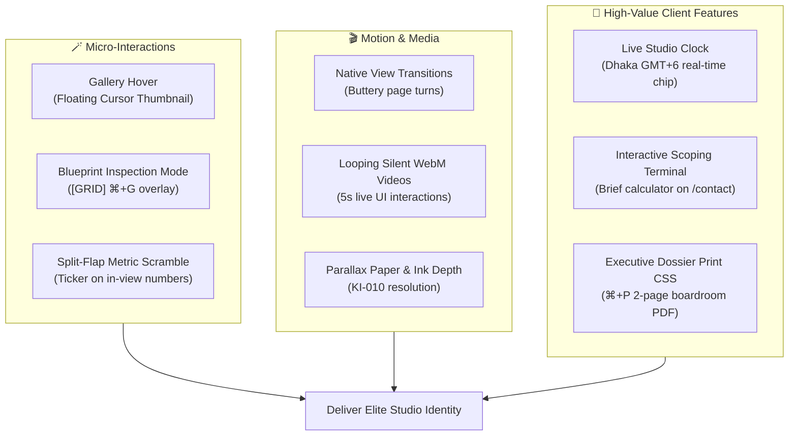

# Visual Asset Specification & Interactive Feature Plan

**Project:** Team NJS Portfolio (`D:\WebDev\portfolio`)  
**Design Persona:** High-End Architect ([ADR-006](ADR/006-visual-identity-pivot.md)) & Editorial Sheet ([ADR-007](ADR/007-editorial-reset.md))  
**Status:** Approved Creative Blueprint  
**Last Updated:** 2026-10-23  

---

## 🎯 1. Creative Philosophy: The Monograph Over Stock

To preserve the studio's architectural authority and luxury restraint:

> [!IMPORTANT]
> **Zero generic stock photography.** No handshakes in glass conference rooms, no floating 3D clay illustrations, no generic isometric device mockups.
> 
> The site's imagery operates as an **architectural monograph**: high-contrast, tactile, authentic evidence of working software, physical environments, and the humans behind the code.

---

## 📸 2. Exact Photo & Asset Inventory

All static media assets are organized under [`public/images/`](file:///d:/WebDev/portfolio/public/images).

```
public/
├── images/
│   ├── team/                     # Human proof (Founders)
│   │   ├── nasib-mohammad-arif.jpg
│   │   ├── abu-sayed-md-saad.jpg
│   │   └── jabir-abdullah-haian.jpg
│   ├── studio/                   # Atmospheric environment proof
│   │   └── workspace-dhaka.jpg
│   ├── projects/                 # Work proof (6 Case Studies)
│   │   ├── apex-cloud-erp/
│   │   │   ├── cover.jpg         # 16:9 Hero cover (1920x1080)
│   │   │   ├── detail-01.jpg     # Macro UI/telemetry view (1200x800)
│   │   │   ├── detail-02.jpg     # Architecture/dataflow schema (1200x800)
│   │   │   └── thumb.jpg         # Row hover preview (640x400)
│   │   ├── fitpulse-mobile-app/
│   │   │   ├── cover.jpg
│   │   │   ├── detail-01.jpg
│   │   │   ├── detail-02.jpg
│   │   │   └── thumb.jpg
│   │   ├── logiflow-warehouse-automation/
│   │   │   ├── cover.jpg
│   │   │   ├── detail-01.jpg
│   │   │   ├── detail-02.jpg
│   │   │   └── thumb.jpg
│   │   ├── nordic-fintech-portal/
│   │   │   ├── cover.jpg
│   │   │   ├── detail-01.jpg
│   │   │   ├── detail-02.jpg
│   │   │   └── thumb.jpg
│   │   ├── nebula-tactics-mobile-game/
│   │   │   ├── cover.jpg
│   │   │   ├── detail-01.jpg
│   │   │   ├── detail-02.jpg
│   │   │   └── thumb.jpg
│   │   └── lumina-brand-relaunch/
│   │       ├── cover.jpg
│   │       ├── detail-01.jpg
│   │       ├── detail-02.jpg
│   │       └── thumb.jpg
│   └── og-image.png              # Global social share card (1200x630)
└── logo/
    ├── logo-light.svg            # Dark ink mark on paper
    └── logo-dark.svg             # Bone white mark on cold ink
```

### Detailed Asset Specifications

| Asset ID | Target File | Aspect Ratio | Dimensions | Aesthetic Treatment |
|---|---|---|---|---|
| **Founder 01** | `images/team/nasib-mohammad-arif.jpg` | 4:5 Portrait | 800 × 1000 | Black & white or desaturated editorial duotone. Natural directional light, candid, zero corporate suit cheese. |
| **Founder 02** | `images/team/abu-sayed-md-saad.jpg` | 4:5 Portrait | 800 × 1000 | Matching 4:5 editorial duotone portrait. |
| **Founder 03** | `images/team/jabir-abdullah-haian.jpg` | 4:5 Portrait | 800 × 1000 | Matching 4:5 editorial duotone portrait. |
| **Studio Ambient** | `images/studio/workspace-dhaka.jpg` | 16:9 / 21:9 | 1920 × 1080 | Wide architectural view of the studio desk, multi-monitors running code/wireframes, paper sketches. |
| **Project Covers (×6)**| `images/projects/[slug]/cover.jpg` | 16:9 Landscape | 1920 × 1080 | Crisp, realistic interface hero. High contrast, real viewport crop, pixel-sharp typography. |
| **Project Details (×12)**| `images/projects/[slug]/detail-*.jpg` | 3:2 Landscape | 1200 × 800 | Deep macro crops: real telemetry graphs, mobile screen in hand, and SVG architecture topology schemas. |
| **Hover Thumbs (×6)**| `images/projects/[slug]/thumb.jpg` | 16:10 | 640 × 400 | Monochromatic or subtle color preview for cursor-driven row reveals. |
| **Global OpenGraph**| `images/og-image.png` | 1.91:1 | 1200 × 630 | Editorial typography card, International Orange signature mark, site tagline and domain. |

---

## 📍 3. Placement & Wireframe Blueprint

### 3.1 Studio Page (`/about`) & Team (`/team`)
* **Chapter 01 (Story & Philosophy):**
  * Features the authentic `images/studio/workspace-dhaka.jpg` landscape photo (16:9 1920 × 1080) demonstrating the real studio workspace environment in Dhaka, Bangladesh.
* **Chapter 02 (Leadership - "Three founders, one room"):**
  * Displays 4:5 duotone photos (`images/team/*.jpg`) beside founder names, verified roles, skills, and authentic LinkedIn links.
  * Hairline 2px border radius, subtle hover scale (`scale-[1.01]`), crisp captions.
* **Team Page (`/team`):**
  * 3-column founder portrait cards matching the Studio dossier.

### 3.2 Home Page (`/`)
* **Movement 02 (Work Index):**
  * Remains primarily typographic rows by default.
  * Hovering any project row triggers the **Cursor-Driven Floating Reveal** (see Section 4.1).
* **Movement 04 (Studio Statement):**
  * Subtle atmospheric background texture using `images/studio/workspace-dhaka.jpg` with heavy opacity masking (`opacity-10`) behind the dark canvas.

### 3.3 Portfolio Archive (`/portfolio`)
* **Case Study Rows:**
  * Uses `<ProjectRow variant="detailed" />` with interactive thumbnail popover or inline responsive thumbnail toggle.

### 3.4 Case Study Detail Pages (`/portfolio/[slug]`)
* **Hero Section:** Full-width 16:9 cover image with micro-radius border and subtle hard offset shadow.
* **Between Problem & Approach:** Split 2-column gallery displaying `detail-01.jpg` (Data/UI) and `detail-02.jpg` (System topology/mobile screen).

---

## ⚡ 4. Interactive Quirks, Motion & Media Innovations



### 4.1 The "Gallery Hover" (Cursor-Driven Thumbnail Reveal)
* **Behavior:** When hovering project rows in [`WorkIndex`](file:///d:/WebDev/portfolio/components/sections/WorkIndex.tsx) or [`PortfolioFilterGrid`](file:///d:/WebDev/portfolio/components/portfolio/PortfolioFilterGrid.tsx), a 280×175px floating thumbnail smoothly fades in and follows the mouse cursor with gentle spring physics.
* **Benefit:** Delivers rich visual gratification without cluttering the clean editorial layout. Respects mobile by disabling on touch screens.

### 4.2 Blueprint Inspection Mode (`[GRID]` / `⌘+G`)
* **Behavior:** A discrete toggle button in the footer (and `⌘+G` keyboard shortcut) overlays an architectural blueprint grid across the site:
  * Visualizes 12-column lines, vertical baseline rhythm, and gutter measurements (`px-gutter`).
  * Shows CSS token tags (`font-display`, `text-display-xl`, `border-accent`).
* **Benefit:** An unforgettable easter egg for engineering managers and design leads that proves craftsmanship and precision.

### 4.3 Split-Flap / Scramble Typography on Metrics
* **Behavior:** When numbers like `74%`, `€12M+`, `180 hrs`, and `99.98%` scroll into view, the mono digits scramble for 350ms before locking into their final values.
* **Benefit:** Adds mechanical tactile delight reminiscent of departure boards and high-frequency trading terminals.

### 4.4 Live Studio Clock & Global Status Chip
* **Behavior:** In the navbar or footer: `DHAKA 15:42 GMT+6 · STUDIO OPEN`.
* **Benefit:** Immediately establishes real geographical grounding and reassures European/US clients of international operational hours.

### 4.5 Interactive Scoping Terminal on `/contact`
* **Behavior:** A 3-question terminal interface above the form:
  * Platform: *Web App* | *Mobile App* | *Automation & ETL*
  * Scope: *MVP Sprint (4-6 wks)* | *Scale / Rewrite (8-12 wks)* | *Ongoing Pod*
  * Outputs recommended architecture stack and pre-fills the message field in the contact form with a structured brief.

### 4.6 Executive Dossier Print Stylesheet (`@media print`)
* **Behavior:** When an enterprise client or agency partner presses `Ctrl+P` / `Cmd+P` on `/about` or `/portfolio/[slug]`, all web navigation, theme toggles, and buttons are stripped out. The content formats into a clean, 2-page black-and-white executive PDF summary suitable for boardroom presentations.

### 4.7 Silent Looping Micro-Videos (WebM/MP4)
* **Behavior:** For complex interactive products (e.g. `fitpulse-mobile-app` or `logiflow-warehouse-automation`), embed 5-second, 60fps silent looping video clips (`playsinline autoPlay muted loop`).
* **Benefit:** Demonstrates fluidity that static screenshots cannot convey.

---

## 🗓️ 5. Implementation Priority Roadmap

| Tier | Feature / Asset | Effort | Client Conversion Impact |
|---|---|---|---|
| **Tier 1 (Core Visuals)** | **Founder Portraits & Case Study Hero Covers** | Medium | **Essential** — Resolves [`KI-005`](file:///d:/WebDev/portfolio/docs/KNOWN_ISSUES.md#L15) |
| **Tier 1 (Interaction)** | **Gallery Hover (Cursor Thumbnail Reveal)** | ~1.5 hrs | **Massive** — Unifies minimal text with visual proof |
| **Tier 1 (Utility)** | **Live Studio Clock & Global Status** | ~30 mins | **High** — Signals active international delivery |
| **Tier 1 (Utility)** | **Executive Dossier Print CSS (`@media print`)** | ~1 hr | **High** — Unlocks boardroom PDF exports |
| **Tier 2 (Polish)** | **Metric Scramble / Split-Flap Roll** | ~1 hr | **Delight** — High-end mechanical feel |
| **Tier 2 (Polish)** | **Blueprint Inspection Mode Grid (`⌘+G`)** | ~1.5 hrs | **Memorable** — Proof of technical mastery |
| **Tier 2 (Media)** | **Silent WebM Micro-Videos for Case Studies** | ~1.5 hrs | **High** — Demonstrates 60fps responsiveness |
| **Tier 3 (Advanced)** | **Interactive Scoping Terminal on `/contact`** | ~2 hrs | **High** — Accelerates qualified inbound briefs |
