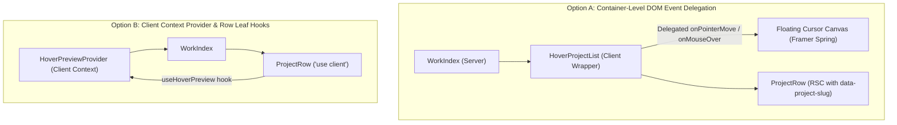
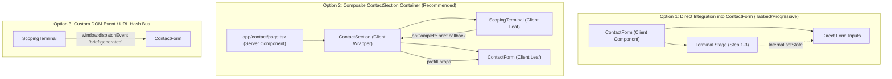
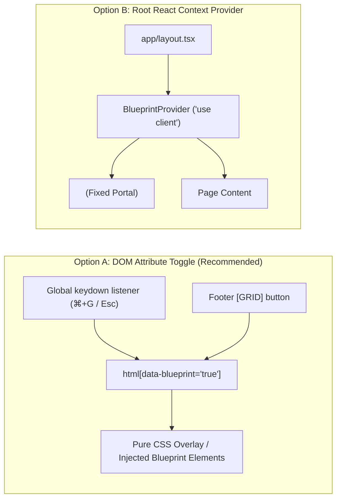

# Phase 5 Implementation Plan: Architectural Re-Evaluation & Trade-Off Analysis

> **Scope:** Phase 5 Interactive Features for Team NJS Portfolio  
> **Exclusions:** Feature 5.2 (Live Studio Clock) is explicitly rejected and omitted.  
> **Invariants:** Next.js static export (`output: 'export'`), 26 prerendered routes, 66/66 E2E tests passing, 0 hardcoded brand strings, strict client component isolation (AGENTS.md Principle 3 & 4).

---

## 🔬 Executive Evaluation & Gap Analysis of Draft 1

A re-examination of the initial Phase 5 draft against the actual codebase reveals **four non-minor architectural tensions** that were either oversimplified or harbored hidden failure modes:

1. **Gallery Hover (`WorkIndex` vs. `PortfolioFilterGrid`):**  
   `WorkIndex` is a pure Server Component; `PortfolioFilterGrid` is a Client Component. Both render `<ProjectRow />`. Passing hover callbacks across Server/Client boundaries is invalid in React Server Components. Furthermore, `public/images/projects/` contains zero image files today (only `.gitkeep`). Attempting to display `/images/projects/*-thumb.jpg` will trigger 404s and broken image UI unless an architectural asset-fallback strategy is defined.

2. **Scoping Terminal State Coupling on `/contact`:**  
   [`components/forms/ContactForm.tsx`](file:///d:/WebDev/portfolio/components/forms/ContactForm.tsx) is a 306-line verified client component with `<React.Suspense>`-isolated `useSearchParams` synchronization, Zod-equivalent validation, honeypot spam protection, and 12 E2E test assertions. Inserting a 3-step terminal brief estimator above it poses a fundamental state-sharing question: should it be embedded directly inside `ContactForm`, wrapped in a composite client container, or decoupled via URL/DOM events?

3. **Blueprint Mode (`[GRID]` / `⌘+G`) Global State Seam:**  
   The trigger is in the `Footer` (or global keyboard shortcut `⌘+G`), but the overlay must render across the entire document viewport from `layout.tsx`. Adding React Context introduces a new client provider wrapping the server component tree, whereas DOM-level attribute toggling avoids React re-renders entirely.

4. **Metric Scramble Hydration & Static Pre-Rendering Invariant:**  
   The previous draft wrongly assumed `ProjectRow` would have to become a Client Component to render a metric scramble, and thus proposed skipping case studies and project rows entirely. In reality, Server Components can freely render Client leaf components. However, scrambling must never mutate the initial SSR/static HTML output, or it will break search indexing and fail existing opaque-box E2E assertions (`74%`, `180 hrs`, `€12M+`).

---

## 🏛️ Deep Dive: The 4 Non-Minor Architectural Areas

---

### Area 1: Gallery Hover (Cursor-Driven Thumbnail Reveal) & Component Boundaries

#### The Architectural Challenge
On desktop (`@media (pointer: fine)`), hovering any project row in [`WorkIndex`](file:///d:/WebDev/portfolio/components/sections/WorkIndex.tsx) or [`PortfolioFilterGrid`](file:///d:/WebDev/portfolio/components/portfolio/PortfolioFilterGrid.tsx) should display a floating 280×175px preview card following the cursor with spring physics.
- `WorkIndex` is an RSC (Server Component).
- `PortfolioFilterGrid` is a Client Component.
- Both consume [`components/portfolio/ProjectRow.tsx`](file:///d:/WebDev/portfolio/components/portfolio/ProjectRow.tsx).
- Passing mouse event handler functions (`onMouseEnter`, `onMouseLeave`) from Server Components is forbidden in Next.js.
- Project images (`thumbnailUrl`) currently do not exist on disk in `public/images/projects/`.

#### Competing Architectural Options

##### Option A: Event-Delegated Client Wrapper (`HoverProjectList`) with Data Attributes (Recommended)
`ProjectRow` remains a clean component that renders standard HTML data attributes (`data-project-slug={project.slug}`, `data-project-title={project.title}`, `data-project-category={project.category}`). A lightweight client wrapper (`HoverProjectList`) surrounds the rows in both `WorkIndex` and `PortfolioFilterGrid`. It listens to bubbling `pointerover`, `pointerout`, and `pointermove` events on the container. A single `<motion.div>` floating card is animated using Framer Motion springs (`useSpring(mouseX)`, `useSpring(mouseY)`).

For missing images, the floating card renders an **Architectural Blueprint Monogram Card** (SVG wireframe with project title, category, and coordinate lines) with a smooth cross-fade to `` if the asset loads.

* **Why do it (Benefits):**
  - **Zero RSC Violation:** `ProjectRow` does not need to accept callback function props, maintaining clean separation.
  - **Single Motion Instance:** Only **one** floating canvas and one pair of spring motion values exist in the DOM, rather than instantiating spring listeners per row.
  - **Performance:** Mouse listeners only bind to the container when pointer is fine (`hover: hover`).
  - **Resilient Fallback:** Zero broken-image icons or blank boxes; renders a beautiful editorial wireframe card until Phase 4 photography lands.
* **Why not do it (Costs / Risks):**
  - Requires reading `e.target.closest('[data-project-slug]')` from delegated DOM events.
  - Adds one wrapper component (`HoverProjectList.tsx`).

##### Option B: Convert `ProjectRow` to `'use client'` with Context Provider
Wrap the page or section in a `HoverPreviewContext.Provider`. Mark `ProjectRow.tsx` with `'use client'`. Each row binds `onMouseEnter={() => setHoveredProject(project)}` and `onMouseLeave={() => setHoveredProject(null)}`.

* **Why do it (Benefits):**
  - Idiomatic React state passing without DOM event delegation or `data-*` attributes.
  - Individual rows directly control their active state.
* **Why not do it (Costs / Risks):**
  - **Violates AGENTS.md Principle 3:** Converts `ProjectRow` (a core layout component used across multiple pages) from a Server Component into a Client Component, bloating the initial JS bundle.
  - Spawns re-renders across all rows whenever hover state changes unless memoized aggressively.
  - High regression risk for server-rendered metadata and links.

##### Verdict
**Adopt Option A.** Preserves Server Component boundaries, maintains a single high-performance spring instance, and handles asset placeholders gracefully via data attributes.

---

### Area 2: Interactive Scoping Terminal & Form State Architecture on `/contact`

#### The Architectural Challenge
The Scoping Terminal is a 3-step monospace guided brief estimator:
1. **Target Platform:** Web Platform | Mobile App | Automation & Integration | Brand System
2. **Engagement Scope:** MVP Sprint (4–6 wks) | Scale & Architecture (8–12 wks) | Dedicated Studio Pod
3. **Synthesis & Handoff:** Computes recommended architectural stack and pre-formats the client's inquiry directly into the contact form below.

[`app/contact/page.tsx`](file:///d:/WebDev/portfolio/app/contact/page.tsx) is currently an RSC rendering `<ContactForm />`. `ContactForm` already manages its own state, validation, and URL parameter pre-selection (`?service=slug`).

#### Competing Architectural Options

##### Option 1: Direct Integration into `ContactForm` as a Mode Toggle
Embed the terminal directly inside [`components/forms/ContactForm.tsx`](file:///d:/WebDev/portfolio/components/forms/ContactForm.tsx). At the top of the form, provide a mode switch: `[ Quick Terminal Estimator ] | [ Direct Form ]`. Completing the terminal directly mutates `formData.service`, `formData.timeline`, and `formData.message`, then scrolls to the input fields.

* **Why do it (Benefits):**
  - **Zero Cross-Component Wiring:** No new wrapper container or prop-drilling needed.
  - **Shared State:** State updates happen directly in `setFormData` with zero latency or sync lag.
  - **One File to Inspect:** Keeps all contact intake logic co-located.
* **Why not do it (Costs / Risks):**
  - **Bloats Existing Component:** `ContactForm.tsx` is already 306 lines. Adding terminal keyboard listeners, steps, and ASCII art pushes it beyond 500 lines.
  - **High Regression Risk:** Modifying `ContactForm` directly threatens existing E2E tests (T2.1–T2.12) which verify input labels, validation errors, and honeypot mechanics.
  - Violates Single Responsibility Principle.

##### Option 2: Composite `ContactSection` Container with Independent Leaf Components (Recommended)
Keep `ContactForm` intact. Add optional props: `initialMessage?: string`, `initialService?: string`, `initialTimeline?: string`. Build `ScopingTerminal.tsx` as an independent `'use client'` component with a clean `onComplete(brief: ScopingBrief)` callback and a `[SKIP TO DIRECT FORM]` button. A client wrapper `components/forms/ContactSection.tsx` mounts both and handles the handoff.

* **Why do it (Benefits):**
  - **Complete Isolation:** `ContactForm` logic remains unpolluted; existing E2E tests for the form remain 100% stable.
  - **Independent Testability:** `ScopingTerminal` can be tested in isolation (step progression, keyboard shortcuts `A`/`B`/`C`/`D`, skip action).
  - **Progressive Disclosure:** Users can collapse or skip the terminal entirely without affecting form availability.
* **Why not do it (Costs / Risks):**
  - Adds two new files: `components/forms/ScopingTerminal.tsx` and `components/forms/ContactSection.tsx`.
  - Requires updating `app/contact/page.tsx` to mount `<ContactSection />` instead of `<ContactForm />` directly.

##### Option 3: Event-Driven Handoff via Custom DOM Event (`window.dispatchEvent`)
`ScopingTerminal` and `ContactForm` remain completely independent siblings without any shared React parent container. When the terminal finishes, it dispatches a `CustomEvent('portfolio:terminal-brief', { detail: { ... } })`. `ContactForm` listens to this event on mount.

* **Why do it (Benefits):**
  - Requires no parent client wrapper; `app/contact/page.tsx` remains a pure Server Component.
* **Why not do it (Costs / Risks):**
  - **Anti-Pattern in React:** Bypasses React's unidirectional data flow for non-DOM coordination.
  - **Fragile Timing:** If the listener mounts after the event fires, the brief is lost.
  - Difficult to test and debug during static export.

##### Verdict
**Adopt Option 2.** Clean architectural seam, protects existing verified form logic, and enables a polished, keyboard-navigable terminal experience with zero E2E regression risk.

---

### Area 3: Blueprint Inspection Mode (`[GRID]` / `⌘+G`) State & Injection Seam

#### The Architectural Challenge
An easter egg for design engineers and technical evaluators: pressing `⌘+G` / `Ctrl+G` (or clicking `[GRID]` in the footer) overlays:
- 12-column architectural grid lines
- Max-width container bounds and gutter markers
- Monospace CSS token badges (`font-display`, `text-display-md`, `border-border`, `accent`)
- Must dismiss cleanly with `Esc` or by re-toggling.

Where does the active state live, and how is the overlay injected into the DOM?

#### Competing Architectural Options

##### Option A: DOM Attribute Toggle (`html[data-blueprint="true"]`) via Isolated Client Leaf (Recommended)
Model this after the theme toggle (`dark` mode class on `<html>`). A tiny `'use client'` component `<BlueprintTrigger />` is mounted once in `app/layout.tsx`. It binds the `keydown` listener (`⌘+G`, `Ctrl+G`, and `Esc`). The `Footer` component provides the visual toggle pill. When active, it toggles `data-blueprint="true"` on `document.documentElement` and renders a fixed, pointer-events-none SVG/CSS overlay.

* **Why do it (Benefits):**
  - **Zero Context Re-renders:** Does not wrap the page tree in a React Context Provider; toggling the grid never causes layout or child re-renders.
  - **Matches Existing Pattern:** Replicates how `next-themes` toggles dark mode classes on `<html>`.
  - **Performance:** When inactive, the overlay has `display: none` or is unmounted, imposing zero performance cost.
* **Why not do it (Costs / Risks):**
  - The footer button needs to read the current DOM attribute to toggle its active visual state (`[GRID: ON]` vs `[GRID]`).

##### Option B: Root React Context (`BlueprintContext`) Wrapping `layout.tsx`
Create a `BlueprintProvider` that wraps `{children}` inside `app/layout.tsx`. Any component (`Footer`, `Navbar`, overlay) calls `useBlueprint()`.

* **Why do it (Benefits):**
  - Standard React idiomatic approach with declarative `isBlueprintActive` boolean state.
* **Why not do it (Costs / Risks):**
  - **Violates Client Isolation:** Wrapping the root children in another React Context can unintentionally force hydration boundaries.
  - Unnecessary overhead for a single visual toggle that has no data dependencies.

##### Verdict
**Adopt Option A.** DOM attribute toggling is identical to the theme system, zero-cost to page render cycles, and completely isolates the inspection layer.

---

### Area 4: Metric Split-Flap / Scramble Typography & Static Export Invariant

#### The Architectural Challenge
Numbers such as `74%`, `€12M+`, `180 hrs`, `99.98%`, and `5+` should roll through mechanical characters for 350ms when scrolling into view.
Crucial constraints:
- Must NOT cause layout shift (jittering character widths).
- Must NOT alter static HTML generated by `next build` (which would break SEO, screen readers, and opaque-box E2E assertions expecting `74%` in the DOM).
- Must respect `prefers-reduced-motion: reduce`.
- Must handle mixed alphanumeric characters, currencies, and suffix units cleanly (e.g. `€12M+`, `180 hrs`).

#### Competing Architectural Options

##### Option A: Client Leaf `<MetricScramble />` with Static Prerender Guarantee (Recommended)
Build `components/ui/MetricScramble.tsx` as an isolated `'use client'` component.
- **Initial Render:** Renders the exact `value` string directly into the DOM (e.g. `74%`). Static HTML export is 100% authentic and correct.
- **Hydration & Observer:** Inside `useEffect`, an `IntersectionObserver` triggers the scramble animation **only once** when scrolled into view.
- **Scramble Engine:** Uses `requestAnimationFrame` over 350ms. Preserves string length, punctuation, spaces, and currency symbols (`€`, `%`, `+`, `hrs`), scrambling only the numeric and core alphanumeric characters.
- **Reduced Motion:** If `window.matchMedia('(prefers-reduced-motion: reduce)').matches` is true, it exits immediately and leaves the static value untouched.

* **Why do it (Benefits):**
  - **Static Export & SEO Safe:** The server-generated HTML always contains the real string. E2E tests asserting exact numbers never fail.
  - **Zero Layout Jitter:** Preserving length and non-numeric positions guarantees zero horizontal layout shifts.
  - **Can Be Rendered from Server Components:** As an isolated leaf component, `<MetricScramble value={result.metric} />` can be placed directly inside Server Components like `ProjectRow.tsx`, `app/about/page.tsx`, and `app/portfolio/[slug]/page.tsx` without converting those pages to Client Components!
* **Why not do it (Costs / Risks):**
  - Requires string parsing logic to differentiate delimiters/units from scramble-eligible characters.

##### Option B: Framer Motion Tween Counter
Use Framer Motion's `animate(from, to)` to tween numeric values from 0 to the target number.

* **Why do it (Benefits):**
  - Uses existing Framer Motion library.
* **Why not do it (Costs / Risks):**
  - **Fails on Non-Numeric Metrics:** Cannot tween strings like `€12M+`, `99.98%`, or `180 hrs`.
  - Does not produce the requested mechanical "split-flap / ticker" roll aesthetic.
  - Complex to format currency and suffixes during the tween.

##### Verdict
**Adopt Option A.** Preserves static export integrity, supports any arbitrary metric string format without layout jitter, and works seamlessly inside Server Components.

---

## 📋 Comprehensive Feature-by-Feature Risk & Architectural Classification

| Feature | Architectural Scale | Requires New Seams? | Key Risks / Failure Modes | Recommended Resolution |
|---|---|---|---|---|
| **5.3 Print CSS** | **Minor** (Pure CSS) | No | Dark mode printing black backgrounds; ink waste. | Global `@media print` in `globals.css` forcing black text on white paper, hiding navigation & CTAs. |
| **5.4 Metric Scramble** | **Architectural** | No (Leaf component) | Layout shifts; SSR hydration mismatch; breaking E2E assertions. | Leaf component with authentic initial SSR output; 350ms rAF loop preserving string length & units. |
| **5.1 Gallery Hover** | **Architectural** | Yes (`HoverProjectList`) | RSC boundary violation; 404s on missing project images. | Delegated event wrapper + Architectural Wireframe Blueprint placeholder card fallback. |
| **5.7 Scoping Terminal** | **Architectural** | Yes (`ContactSection`) | Bloating `ContactForm`; breaking existing E2E form tests. | Independent `ScopingTerminal` leaf wrapped in `ContactSection` passing prefill props to `ContactForm`. |
| **5.5 Blueprint Grid** | **Architectural** | Yes (Layout seam) | Root re-renders; key conflict with text inputs. | DOM attribute toggle (`html[data-blueprint]`) with input focus guard (`e.target instanceof HTMLInputElement`). |
| **5.6 WebM Videos** | **Minor / Deferred** | No | 404 asset errors; bandwidth bloat. | Defer until Phase 4 video clips are provided; use standard `<video>` tag with `playsInline` and fallbacks. |

---

## 🚀 Execution & Verification Roadmap

### Step 1: Feature 5.3 — Executive Dossier Print Stylesheet
- Edit [`styles/globals.css`](file:///d:/WebDev/portfolio/styles/globals.css) to add comprehensive `@media print` rules.
- Test print preview in Chrome DevTools MCP on `/about` and `/portfolio/apex-cloud-erp`.
- Verify 0 regressions across existing pipeline.

### Step 2: Feature 5.4 — Metric Split-Flap / Scramble Typography
- Create [`components/ui/MetricScramble.tsx`](file:///d:/WebDev/portfolio/components/ui/MetricScramble.tsx).
- Wire into:
  - `/about` Studio outcomes metrics.
  - `/portfolio/[slug]` case study headline metrics.
  - [`components/portfolio/ProjectRow.tsx`](file:///d:/WebDev/portfolio/components/portfolio/ProjectRow.tsx) results metric.
- Run `npm run test:e2e` to verify all 66 opaque-box assertions pass untouched.

### Step 3: Feature 5.1 — The Gallery Hover Reveal
- Create [`components/portfolio/HoverProjectList.tsx`](file:///d:/WebDev/portfolio/components/portfolio/HoverProjectList.tsx) with spring physics and architectural wireframe fallback card.
- Add `data-project-*` attributes to `ProjectRow`.
- Mount wrapper in [`components/sections/WorkIndex.tsx`](file:///d:/WebDev/portfolio/components/sections/WorkIndex.tsx) and [`components/portfolio/PortfolioFilterGrid.tsx`](file:///d:/WebDev/portfolio/components/portfolio/PortfolioFilterGrid.tsx).
- Verify mobile/touch suppression (`pointer: coarse`).

### Step 4: Feature 5.7 — Interactive Scoping Terminal
- Create [`components/forms/ScopingTerminal.tsx`](file:///d:/WebDev/portfolio/components/forms/ScopingTerminal.tsx).
- Add prefill props (`initialMessage`, `initialService`, `initialTimeline`) to `ContactForm`.
- Create [`components/forms/ContactSection.tsx`](file:///d:/WebDev/portfolio/components/forms/ContactSection.tsx) and mount in [`app/contact/page.tsx`](file:///d:/WebDev/portfolio/app/contact/page.tsx).
- Add new E2E tests for terminal step progression and skip functionality.

### Step 5: Feature 5.5 — Blueprint Inspection Mode (`[GRID]` / `⌘+G`)
- Create [`components/debug/BlueprintOverlay.tsx`](file:///d:/WebDev/portfolio/components/debug/BlueprintOverlay.tsx) and mount in `app/layout.tsx`.
- Add `[GRID]` toggle button in [`components/layout/Footer.tsx`](file:///d:/WebDev/portfolio/components/layout/Footer.tsx).
- Guard against keypresses when typing in form fields or search inputs.

### Step 6: Full Verification Gate (AGENTS.md Principle 5)
1. `npm run typecheck`
2. `npm run lint`
3. `npm run clean && npm run build`
4. `npm run verify:routes`
5. `npm run verify:brand`
6. `npm run test:e2e`
7. `npm run verify:all`
