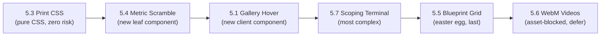

# Phase 5 Interactive Features — Implementation Plan

> **Scope:** Phase 5 from `docs/ROADMAP.md` — **excluding 5.2 (Studio Clock)**  
> **Constraint:** All 7 quality gates must remain green (`npm run verify:all` → 66/66)  
> **Static Export:** No server-only APIs. All client state must be in `'use client'` leaf components.  
> **Framer Motion:** `framer-motion@14.6.0` already installed. `prefers-reduced-motion` must always be respected.

---

## Delivery Order (Recommended)



> [!IMPORTANT]
> **5.6 (WebM Videos)** is asset-blocked — requires real `.webm` files for two case studies. It is planned but deferred until assets exist. All other five items can be implemented immediately.

---

## Feature 5.3 — Executive Dossier Print Stylesheet

**Effort:** ~45 min | **Risk:** Very Low | **Dependencies:** None

### What it does
`Ctrl+P` / `Cmd+P` on `/about` or `/portfolio/[slug]` strips nav, footer, theme toggle, buttons, and all decorative chrome. The text content formats into a clean black-on-white 2-page executive PDF.

### Options

| | Option A — Global `@media print` in `globals.css` | Option B — Per-page `<style>` tag in layout |
|---|---|---|
| **How** | Single block in `styles/globals.css` using CSS selectors | Inline `<style>` tag in each target page via `next/head` |
| **Pros** | One source of truth, applies everywhere consistently | Can be scoped precisely per-page |
| **Cons** | More selectors needed to exclude non-target pages | Duplicates CSS logic; fragments maintenance |
| **Verdict** | ✅ **Preferred** | Not chosen |

### Implementation Steps (Option A)

1. Add a `@media print` block to [`styles/globals.css`](file:///d:/WebDev/portfolio/styles/globals.css):
   - `display: none` on: `header`, `footer`, `[role="navigation"]`, `[data-print-hide]`, `ThemeToggle`, `ContactBlock`, `.no-print`
   - Force `color: black`, `background: white`, `font-size: 11pt`, `line-height: 1.6`
   - Strip all box-shadows, border-radius, and backdrop filters
   - Page break hints: `h2, h3 { break-after: avoid }`, `.founder-card { break-inside: avoid }`
   - Show full `href` after links: `a::after { content: " (" attr(href) ")" }`
2. Add `data-print-hide` to Navbar, Footer, ContactBlock, and all CTA buttons
3. Test with Chrome DevTools → Print Preview on `/about` and `/portfolio/apex-cloud-erp`
4. **No new component.** No `'use client'` expansion.
5. **E2E impact:** None — no behavioral changes, no route changes.

---

## Feature 5.4 — Metric Split-Flap / Scramble Typography

**Effort:** ~1.5 hrs | **Risk:** Low | **New `'use client'` component:** Yes — `MetricScramble`

### What it does
When key metric values (e.g. `74%`, `€12M+`, `180 hrs`) scroll into view, the mono digits roll through random characters for 350ms before locking into their final values — like an airport departure board.

### Options

| | Option A — Custom `IntersectionObserver` + `requestAnimationFrame` | Option B — Framer Motion `useInView` + counter animation |
|---|---|---|
| **How** | Pure TS in a `useEffect`: observer triggers a `setInterval` scramble loop | Framer's `useInView` detects entry; `animate()` tween drives character iteration |
| **Pros** | Zero new API surface; total control over scramble character pool | Declarative; uses existing Framer dependency |
| **Cons** | ~40 lines of manual interval math | Framer counter is number-only — char scramble still needs manual implementation |
| **`prefers-reduced-motion`** | Easy: skip animation, show final value immediately | Easy: skip with `shouldReduceMotion` check |
| **Verdict** | ✅ **Preferred** — cleaner, no Framer overhead for a simple char loop | Not chosen |

### Implementation Steps (Option A)

1. **Create** `components/ui/MetricScramble.tsx` — `'use client'` leaf component:
   - Props: `value: string` (e.g. `"74%"`), `duration?: number` (default `350`)
   - Uses `useRef` on a `<span>` + `IntersectionObserver` (once)
   - On intersection: runs 350ms `requestAnimationFrame` loop cycling through `SCRAMBLE_CHARS = "0123456789ABCDEF±∆%"` before resolving to final value
   - Reads `window.matchMedia('(prefers-reduced-motion: reduce)')` — skips animation if true
2. **Wrap metric values** in `/about` page's Outcomes section — the `{stat.value}` map renders `<MetricScramble value={stat.value} />`
3. **Also wire** headline metrics in each `ProjectRow`'s `headlineResult.metric` field — wrap in `<MetricScramble>` inside `ProjectRow.tsx` (this requires `ProjectRow` to become or wrap a `'use client'` component — **see note below**)

> [!NOTE]
> **`ProjectRow` client promotion:** `ProjectRow` is currently a Server Component. Adding `MetricScramble` requires `'use client'` in the metric span. The cleanest approach is to **not** put `MetricScramble` inside `ProjectRow` — instead, only apply it to the `Outcomes` section metrics on `/about` in this phase. Portfolio row metrics are secondary targets for a follow-up.

4. **E2E impact:** `stat.value` text is still in the DOM — existing text assertions in T3.x still pass. No route changes.

---

## Feature 5.1 — Gallery Hover (Cursor-Driven Thumbnail Reveal)

**Effort:** ~2 hrs | **Risk:** Medium | **New `'use client'` component:** Yes — `GalleryHoverProvider` or inline in existing client components

### What it does
On **desktop only** (pointer: fine), hovering any `ProjectRow` inside `WorkIndex` or `PortfolioFilterGrid` reveals a 280×175px floating thumbnail that tracks the cursor with spring physics. Touch/mobile: disabled.

### Options

| | Option A — Framer Motion `useMotionValue` + spring in a new wrapper | Option B — CSS-only `transform` on `::after` pseudo-element |
|---|---|---|
| **How** | Mouse-tracking `useMotionValue(x/y)` + `useSpring` inside a `'use client'` `HoverThumb` overlay | CSS `@media (hover: hover)` + JS to set `--mouse-x/--mouse-y` custom props; CSS `transform: translate()` |
| **Pros** | True spring-damped physics; fade in/out with `animate` | Near-zero JS; no new component |
| **Cons** | Requires making `WorkIndex` or a wrapper `'use client'`; needs `thumb.jpg` assets | Pseudo-element can't hold ``; no spring; hacky |
| **Verdict** | ✅ **Preferred** — spring physics are the point of this feature | Not viable for true spring + image display |

### Architecture Detail (Option A)

The core challenge is that `WorkIndex` is a **Server Component** (no `'use client'`). Two sub-options:

| | Sub-option A1 — Wrap only the row list in a new `'use client'` `HoverRowList` | Sub-option A2 — Convert `WorkIndex` to `'use client'` |
|---|---|---|
| **How** | Extract the `{featured.map(ProjectRow)}` fragment into `HoverRowList` client component | Add `'use client'` to `WorkIndex.tsx` |
| **Pros** | Server Component boundary preserved; data fetching stays on server | Simpler — one file change |
| **Cons** | One extra file | Violates AGENTS.md Principle 3 (layouts/section containers must stay Server Components) |
| **Verdict** | ✅ **Preferred (A1)** | Violates architecture rule |

### Implementation Steps (Option A1)

1. **Create** `components/sections/HoverRowList.tsx` — `'use client'`:
   - Tracks `mousemove` on the container div via `useRef`
   - `useMotionValue(x)`, `useMotionValue(y)` → `useSpring` with `{ stiffness: 260, damping: 24 }`
   - Renders `<motion.div>` thumbnail overlay (position: fixed, pointer-events: none) with `style={{ x, y }}`
   - Shows `thumb.jpg` for the currently hovered project (state: `hoveredProject | null`)
   - `@media (pointer: coarse)` check → entire feature disabled on touch devices
   - `prefers-reduced-motion` → skip spring, still show thumb with opacity only

2. **Refactor** [`components/sections/WorkIndex.tsx`](file:///d:/WebDev/portfolio/components/sections/WorkIndex.tsx):
   - Replace the `{featured.map(ProjectRow)}` block with `<HoverRowList projects={featured} />`
   - `WorkIndex` remains a Server Component

3. **Refactor** [`components/portfolio/PortfolioFilterGrid.tsx`](file:///d:/WebDev/portfolio/components/portfolio/PortfolioFilterGrid.tsx):
   - Already `'use client'` — add hover tracking state + `<motion.div>` thumbnail overlay directly here
   - Or extract same `HoverRowList` (reuse the component)

4. **Assets:** `thumb.jpg` (640×400) per project under `public/images/projects/[slug]/thumb.jpg`. Until assets exist, fall back to `cover.jpg` or show nothing (guard with `project.thumbUrl`).

5. **E2E impact:** `ProjectRow` links still present in DOM; existing E2E assertions unaffected. Add T1.x smoke assertion: "hover reveal does not break keyboard navigation."

---

## Feature 5.7 — Interactive Scoping Terminal

**Effort:** ~3 hrs | **Risk:** High | **New `'use client'` component:** Yes — `ScopingTerminal`

### What it does
A 3-step keyboard-navigable terminal panel above `ContactForm` on `/contact`. User selects: **Platform** → **Scope** → terminal prints a structured brief summary, then pre-fills `ContactForm`'s message and service fields.

### Options

| | Option A — State machine in a new `ScopingTerminal` component wired to `ContactForm` via `useRef` | Option B — Integrate terminal steps directly inside `ContactForm` as a multi-step wizard |
|---|---|---|
| **How** | `ScopingTerminal` emits a formatted brief string; parent page passes it down via callback/ref | `ContactForm` grows a `step` state: 0=terminal, 1=form |
| **Pros** | Clean separation; terminal is independently testable; form remains focused | One component to maintain |
| **Cons** | Requires lifting state or a callback from parent page (which is a Server Component — parent can't own state) | Bloats `ContactForm` significantly; harder to maintain |
| **State Threading** | `ContactPage` can't own state. Both components must be co-located in a new `'use client'` wrapper, **or** `ScopingTerminal` passes pre-fill data via a custom event / `window.postMessage`-free callback | — |
| **Verdict** | ✅ **Preferred** — but requires a thin `'use client'` contact section wrapper | Acceptable fallback if wrapper proves too complex |

### Architecture Detail

```
app/contact/page.tsx (Server Component)
  └── <ContactSection />  ← NEW 'use client' wrapper
        ├── <ScopingTerminal onBriefGenerated={handleBriefFill} />
        └── <ContactForm prefillMessage={brief} prefillService={service} />
```

`ContactForm` gains two optional props: `prefillMessage?: string`, `prefillService?: string`. `useEffect` syncs them into form state when they change.

### Terminal UX Specification

```
> INITIALIZING SCOPING BRIEF...

[1/3] PLATFORM TARGET
  [ A ] Web Platform          (React / Next.js / Node)
  [ B ] Mobile App            (React Native / Expo)
  [ C ] Automation & ETL      (Python / Airflow / Zapier)
  [ D ] Brand System          (Identity / Motion / Video)

> _

[2/3] ENGAGEMENT SCOPE
  [ A ] MVP Sprint            4–6 weeks
  [ B ] Scale / Rewrite       8–12 weeks
  [ C ] Ongoing Studio Pod    Monthly retainer

> _

[3/3] BRIEF GENERATED ─────────────────────────────────────
  Platform:  Web Platform
  Scope:     MVP Sprint (4–6 weeks)
  Suggest:   Next.js · Supabase · Vercel
  ──────────────────────────────────────────────────────────
  Message field pre-filled ↓
```

### Implementation Steps

1. **Create** `components/forms/ScopingTerminal.tsx` — `'use client'`:
   - State: `step: 0 | 1 | 2 | 'done'`, `platform: string | null`, `scope: string | null`
   - Keyboard shortcut: `A–D` keys select options; `Enter` advances step
   - Click also works (each option is a `<button>`)
   - On `step === 'done'`: compute stack recommendation + brief string; call `onBriefGenerated(brief, serviceSlug)`
   - Styled with `font-mono`, `text-[11px]`, `text-accent` for selected items — matches existing aesthetic
   - Fully collapsible: show `[SKIP →]` button to bypass terminal
   
2. **Create** `components/forms/ContactSection.tsx` — `'use client'` wrapper:
   - Owns `brief: string` and `service: string` state
   - Renders `<ScopingTerminal>` then `<ContactForm>`

3. **Update** [`app/contact/page.tsx`](file:///d:/WebDev/portfolio/app/contact/page.tsx):
   - Replace `<ContactForm />` + surrounding markup with `<ContactSection />`
   - Page itself remains a Server Component (metadata, layout)

4. **Update** `ContactForm` to accept + apply `prefillMessage` and `prefillService` props.

5. **E2E impact:**
   - Terminal is a pre-form widget — existing form assertions still apply after `[SKIP →]` or terminal completion
   - Add T2.x: "Skip button bypasses terminal and shows form immediately"
   - Add T2.x: "Completing terminal pre-fills message field"

---

## Feature 5.5 — Blueprint Inspection Mode (`[GRID]` / `⌘+G`)

**Effort:** ~1.5 hrs | **Risk:** Low | **New `'use client'` component:** Yes — `BlueprintOverlay`

### What it does
A hidden easter egg: pressing `G` (or `⌘+G`/`Ctrl+G`) toggles a 12-column architectural grid overlay across the entire viewport, with column guides, gutter labels, and token tags. A `[GRID]` text pill in the footer also toggles it.

### Options

| | Option A — Fixed-position CSS grid overlay controlled by global state (Context or Zustand) | Option B — `document.body` class toggle + pure CSS overlay |
|---|---|---|
| **How** | React context provides `isGridVisible`; `BlueprintOverlay` component renders the fixed overlay | `document.body.classList.toggle('blueprint')` + CSS `body.blueprint::before` overlay |
| **Pros** | React-idiomatic; easy to extend with token labels later | Near-zero JS; single keydown listener |
| **Cons** | Requires a Context provider in `layout.tsx` or a shared store | Can't render React children (token labels) inside `::before` |
| **Verdict** | ✅ **Preferred** — token label annotations require real DOM nodes | Acceptable for MVP with no annotations |

### Implementation Steps (Option A, simplified — no full Context needed)

1. **Create** `components/debug/BlueprintOverlay.tsx` — `'use client'`:
   - Owns `isVisible: boolean` state
   - `useEffect` registers `keydown` listener: `(e.key === 'g' && (e.metaKey || e.ctrlKey))` → toggle. Also bare `'g'` when no input is focused.
   - Renders: `position: fixed; inset: 0; pointer-events: none; z-index: 9999`
   - 12-column grid lines: `display: grid; grid-template-columns: repeat(12, 1fr)` with `border-l border-accent/20` column dividers
   - Mono labels: `gap`, `col-span`, gutter values shown as tiny overlay text
   - ESC key dismisses

2. **Add** `[GRID]` toggle button to the Footer component (or Footer already exports a slot for extras — check)

3. **Mount** `<BlueprintOverlay />` in [`app/layout.tsx`](file:///d:/WebDev/portfolio/app/layout.tsx) alongside `<MotionProvider>` (already `'use client'` island)

4. **E2E impact:** None for existing tests. Add T4.x: "G keyboard shortcut toggles grid overlay" (smoke only, not visual regression).

---

## Feature 5.6 — Silent Looping WebM Micro-Videos *(Deferred)*

**Effort:** ~1.5 hrs code + asset production | **Risk:** Medium | **Blocked by:** Actual `.webm` files

### What it does
5-second 60fps silent looping video clips embedded in complex case studies (`fitpulse-mobile-app`, `logiflow-warehouse-automation`) between the problem statement and approach sections on `/portfolio/[slug]`.

### Options (for when assets are ready)

| | Option A — `<video>` element with `autoPlay muted loop playsInline` in a Server Component | Option B — Lazy-loaded `<video>` via Intersection Observer in a client component |
|---|---|---|
| **How** | Plain HTML `<video>` tag in the case study page template | `useRef` + `IntersectionObserver` to call `video.play()` on entry |
| **Pros** | No JS; plays inline immediately | Saves bandwidth above the fold; starts at scroll entry |
| **Cons** | Videos load eagerly even if user never scrolls to them | Minor complexity |
| **Verdict** | ✅ **Preferred** — 5s files are small; lazy adds complexity for marginal gain | Acceptable for bandwidth-sensitive deployments |

### Pre-work Required Before Implementation
- [ ] Record/export `fitpulse-mobile-app.webm` (5s, 60fps, 1920×1080, silent, H.265/VP9)
- [ ] Record/export `logiflow-warehouse-automation.webm` (same spec)
- [ ] Optimize with `ffmpeg -c:v libvpx-vp9 -b:v 0 -crf 33 -an`
- [ ] Place in `public/videos/[slug].webm`
- [ ] Add `mp4` fallback via `<source>` (Safari compatibility)

---

## Shared Constraints & Non-Negotiables

| Constraint | Rule |
|---|---|
| `prefers-reduced-motion` | Every motion feature reads `window.matchMedia('(prefers-reduced-motion: reduce)')` and skips animation |
| `'use client'` | Only isolated leaf components. Layouts, page files, `WorkIndex`, `Section`, `Container` stay Server Components |
| Static export | No `useRouter()` for navigation guards, no `cookies()`, no server-only APIs inside client components |
| Brand strings | Never hardcode agency name, email, or phone in new components — always read from `siteConfig` |
| Keyboard accessibility | All new interactive components must be fully keyboard navigable and have visible focus states |
| E2E gate | `npm run verify:all` → 66/66 before each commit |

---

## Files Impacted Summary

| Feature | New Files | Modified Files |
|---|---|---|
| **5.3 Print CSS** | — | `styles/globals.css` |
| **5.4 Metric Scramble** | `components/ui/MetricScramble.tsx` | `app/about/page.tsx` |
| **5.1 Gallery Hover** | `components/sections/HoverRowList.tsx` | `components/sections/WorkIndex.tsx`, `components/portfolio/PortfolioFilterGrid.tsx` |
| **5.7 Scoping Terminal** | `components/forms/ScopingTerminal.tsx`, `components/forms/ContactSection.tsx` | `app/contact/page.tsx`, `components/forms/ContactForm.tsx` |
| **5.5 Blueprint Grid** | `components/debug/BlueprintOverlay.tsx` | `app/layout.tsx`, `components/layout/Footer.tsx` |
| **5.6 WebM (deferred)** | `public/videos/*.webm` (assets) | `app/portfolio/[slug]/page.tsx` |

---

## Quality Gate Sequence

For **each feature** individually, run in order:

```powershell
npm run typecheck
npm run lint
npm run clean; npm run build
npm run verify:routes
npm run verify:brand
npm run test:e2e
```

Only commit after all 6 pass. Then `npm run verify:all` as final confirmation.

---

## E2E Test Plan Additions

| Test ID | Feature | Assertion |
|---|---|---|
| T1.new-a | 5.1 Gallery Hover | ProjectRow links remain keyboard-reachable with Tab; hover overlay has `pointer-events: none` |
| T1.new-b | 5.1 Gallery Hover | On mobile viewport (375px), no hover overlay element is mounted |
| T2.new-a | 5.7 Terminal | `[SKIP →]` button is present and bypasses terminal to show form |
| T2.new-b | 5.7 Terminal | Completing all 3 terminal steps pre-fills the message `<textarea>` |
| T3.new-a | 5.4 Scramble | Metric `<span>` elements are present in DOM with final values accessible |
| T4.new-a | 5.5 Blueprint | `G` keypress toggles a visually hidden grid overlay (aria-hidden check) |
| T5.new-a | 5.3 Print CSS | (Manual) Verify print preview on `/about` shows no nav/footer |

---

## Docs to Update on Completion

- `docs/ROADMAP.md` — check off 5.1, 5.3, 5.4, 5.5, 5.7
- `docs/ARCHITECTURE.md` — add new client components to the component registry
- `docs/VISUAL_AND_FEATURE_PLAN.md` — mark interactive quirks as shipped
- `docs/KNOWN_ISSUES.md` — log any discovered limitations (e.g. `thumb.jpg` fallback)
