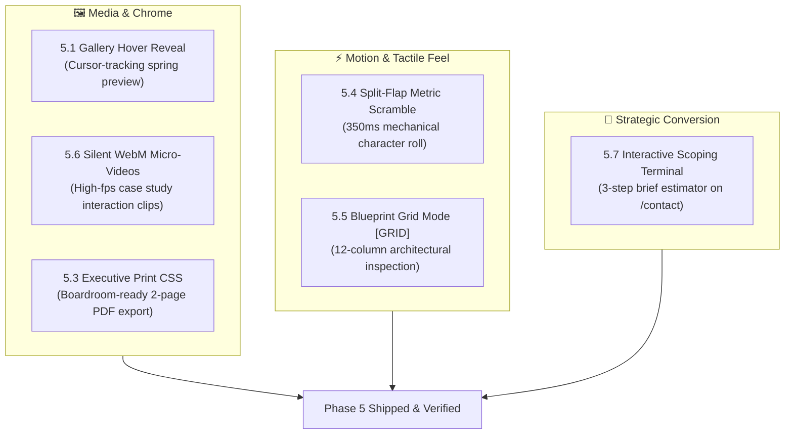

# Phase 5: Modern Architecture & Implementation Plan

> **Design Persona:** High-End Architectural Studio & Tactical Editorial Sheet  
> **Target Environment:** Next.js Static Export (`output: 'export'`), Hostinger Production Hosting  
> **Guiding Principle:** Modern engineering advancements first; living guidance over dogma.  
> **Exclusions:** Feature 5.2 (Live Studio Clock) is explicitly rejected and excluded.  
> **Media Policy:** All media features use realistic high-contrast editorial placeholders during development. Missing photography/videos will NEVER block feature delivery.

---

## 🗺️ Architectural Map of Phase 5



---

## 🔬 Feature-by-Feature: Modern Architectural Options & Real Technical Risks

---

### Feature 5.1: The "Gallery Hover" (Cursor-Driven Thumbnail Reveal)

#### What it achieves
When hovering any project row on desktop (`@media (pointer: fine)` and `hover: hover`) in [`WorkIndex`](file:///d:/WebDev/portfolio/components/sections/WorkIndex.tsx) or [`PortfolioFilterGrid`](file:///d:/WebDev/portfolio/components/portfolio/PortfolioFilterGrid.tsx), a 280×175px floating thumbnail smoothly fades in and tracks the cursor with spring physics. On mobile/touch, the feature is cleanly disabled.

#### Competing Modern Architectural Options

##### Option 1: Framer Motion Spring Orchestration with Delegated Pointer Bus (Recommended)
`ProjectRow` remains a Server Component emitting standard HTML data attributes (`data-project-slug`, `data-project-thumb`, `data-project-title`). A single client wrapper `<HoverProjectList>` mounts around the rows. It attaches a single passive `pointermove` and delegated `pointerover`/`pointerout` listener to its container. A single `<motion.div>` floating card is positioned with `useSpring(mouseX)` and `useSpring(mouseY)`.

For media, we generate 6 high-contrast architectural placeholder thumbnails (`public/images/projects/[slug]/thumb.jpg`) featuring vector blueprint wireframes and title tags so the feature is immediately testable and visually striking.

* **Why do it (Benefits):**
  - **Authentic Physical Inertia:** Real spring physics (mass, damping, stiffness) provide the tactile luxury feel demanded by high-end design agency benchmarks.
  - **Single GPU Surface:** Only **one** floating canvas element exists in the DOM at any time.
  - **Zero RSC Violation:** `ProjectRow` remains a clean, high-performance Server Component that does not require callback function props.
  - **Immediate Visual Polish:** Uses crisp placeholder thumbnails right now; seamless swap when client photography lands.
* **Why not do it (Real Technical Risks & Costs):**
  - **Viewport Edge Clipping:** If the cursor moves near the right or bottom screen boundary, the preview card can overflow the viewport unless an edge-clamping algorithm is implemented in the spring hook.
  - **Paint Thread Latency on Low-Powered Devices:** Rapid cursor movement across rows on low-end hardware can cause minor frame drops if the spring damping calculation is unthrottled.
  - **Rule Impact:** Requires wrapping row lists in a client component, slightly increasing client bundle JS (~3.2KB).

##### Option 2: Modern CSS Anchor Positioning + `@starting-style` + Popover API (Native Web Platform)
Use the browser's native Popover API (`popover="manual"`) combined with CSS Anchor Positioning (`anchor-name`, `position-anchor`) and `@starting-style` for hardware-accelerated entry and exit transitions.

* **Why do it (Benefits):**
  - **Zero JavaScript Runtime:** Runs 100% on the browser's compositor thread; zero JS execution during hover.
  - **Top-Layer Rendering:** The native HTML Popover API places the preview in the browser's top layer, permanently solving z-index battles and `overflow: hidden` clipping.
  - **Zero Framer Motion Overhead:** Eliminates motion library dependencies for this feature.
* **Why not do it (Real Technical Risks & Costs):**
  - **Browser Incompatibility (Firefox & Older Safari):** CSS Anchor Positioning is supported in Chromium 125+ and Safari 18.2+, but remains behind an experimental flag in Firefox (`layout.css.anchor-positioning.enabled`). Unsupported browsers see no hover effect or misaligned popovers.
  - **Absence of Spring Inertia:** CSS anchor positioning can transition smoothly, but cannot simulate authentic physical mass, velocity, or spring overshoot. The preview feels like a standard tooltip rather than a dynamic floating reveal.

##### Verdict
**Adopt Option 1.** Cross-browser reliability, authentic spring physics, and a single delegated canvas make it vastly superior for an editorial portfolio, with edge-clamping addressing the clipping risk.

---

### Feature 5.4: Metric Split-Flap / Scramble Typography

#### What it achieves
When key numerical metrics (`74%`, `€12M+`, `180 hrs`, `99.98%`, `5+`) scroll into the viewport, their digits rapidly cycle through mechanical characters for 350ms before locking into their final values—reminiscent of Swiss railway departure boards and financial terminals.

#### Competing Modern Architectural Options

##### Option 1: Isolated `<MetricScramble />` Leaf with Authentic Static SSR & A11y Guard (Recommended)
Build `components/ui/MetricScramble.tsx` as an isolated `'use client'` component.
- **Static Export Invariant:** The initial server/static render outputs the **exact** final string (`74%`). Static HTML files generated during `npm run build` are 100% authentic, preserving SEO and ensuring all 66 opaque-box E2E assertions pass.
- **Screen Reader Protection (`a11y`):** The scrambled animation is marked `aria-hidden="true"`, while an accessible `<span className="sr-only">74%</span>` guarantees screen readers never announce scramble noise.
- **Scramble Engine:** Driven by `requestAnimationFrame` over 350ms upon `IntersectionObserver` trigger. Scrambles only numeric/alphanumeric characters while locking spaces, currency symbols (`€`), and unit suffixes (`hrs`).
- **Reduced Motion:** If `prefers-reduced-motion: reduce` is active, the animation loop is bypassed entirely.

* **Why do it (Benefits):**
  - **100% Static Export & SEO Safe:** Crawlers and automated tests read authentic numbers.
  - **Zero Layout Shift (CLS):** String length is strictly preserved throughout the animation; combined with `font-mono` / `tabular-nums`, character widths never jitter.
  - **Server Component Compatible:** Can be rendered directly from Server Components (`ProjectRow.tsx`, `app/about/page.tsx`, `app/portfolio/[slug]/page.tsx`) without promoting those pages to client components.
* **Why not do it (Real Technical Risks & Costs):**
  - **rAF Heap Accumulation on Fast Scroll:** If a user scrolls rapidly through multiple metric grids, multiple rAF loops could run concurrently if not properly unobserved on exit.
  - **String Parsing Overhead:** Requires regex character classification to distinguish rollable digits from symbols.

##### Option 2: CSS Scroll-Driven Animation (`@keyframes` + `animation-timeline`)
Use modern CSS Scroll-Driven Animations with CSS `@counter-style` and vertical text-mask sliding.

* **Why do it (Benefits):**
  - Zero JavaScript on the main thread; completely compositor-driven.
* **Why not do it (Real Technical Risks & Costs):**
  - **Browser Compatibility Breakdown:** Safari and Firefox have incomplete support for CSS scroll-driven animations; Safari 18 still lacks full support for `animation-timeline: view()`.
  - **Inability to Handle Mixed Strings:** CSS counter styles cannot handle complex units or mixed strings like `€12M+` or `180 hrs`.
  - **Rigid Triggering:** Animations are strictly tied to scroll delta rather than a one-shot entrance trigger upon crossing the viewport threshold.

##### Verdict
**Adopt Option 1.** Flawless static export compliance, zero layout shift, screen-reader accessibility, and universal browser support.

---

### Feature 5.7: Interactive Scoping Terminal (`/contact`)

#### What it achieves
A 3-step terminal brief estimator on `/contact`:
1. **Platform Selection:** Web Platform | Mobile App | Automation & ETL | Brand Systems
2. **Scope Determination:** MVP Sprint (4–6 wks) | Scale & Rewrite (8–12 wks) | Dedicated Studio Pod
3. **Synthesis & Handoff:** Computes recommended tech stack and automatically pre-fills the inquiry message, service dropdown, and timeline in the contact form below.

#### Competing Modern Architectural Options

##### Option 1: Decoupled `ScopingTerminal` Leaf via Composite `ContactSection` Container (Recommended)
Keep [`ContactForm.tsx`](file:///d:/WebDev/portfolio/components/forms/ContactForm.tsx) completely intact. Give it optional props: `initialMessage?: string`, `initialService?: string`, `initialTimeline?: string`. Build `components/forms/ScopingTerminal.tsx` as an independent client component with a clean `onComplete(brief)` callback and a prominent `[SKIP / ENTER DIRECT DETAILS]` escape button. A client wrapper `ContactSection.tsx` mounts both and handles brief handoff.

* **Why do it (Benefits):**
  - **Zero Regression Risk for Core Form:** `ContactForm`'s existing honeypot, validation, submission, and 12 E2E test assertions remain 100% untouched.
  - **Unrestricted User Agency:** Direct buyers with existing RFPs can skip or ignore the terminal immediately.
  - **Keyboard Isolation:** Terminal keyboard listeners (`A`, `B`, `C`, `Enter`) are scoped strictly to the terminal container, avoiding keystroke capture collisions when typing in input fields.
* **Why not do it (Real Technical Risks & Costs):**
  - **State Overwrite Conflict:** If a user types a custom message in the form, then later clicks through the terminal, pre-filling could overwrite their typed text unless an append/merge confirmation is handled.
  - **Rule Impact:** Promotes the left column wrapper in `/contact` to a client component (Server Component boundary moves up one level).

##### Option 2: Monolithic Mode Switch within `ContactForm`
Embed the terminal directly inside `ContactForm.tsx` as a stateful view toggle (`mode: 'terminal' | 'direct'`). Completing the terminal directly mutates `formData` in memory and flips to the direct inputs.

* **Why do it (Benefits):**
  - Single component state machine; zero cross-component prop passing.
* **Why not do it (Real Technical Risks & Costs):**
  - **High Regression Risk for Verified Tests:** Adding another layer of state machine logic to an already verified 306-line component risks breaking existing E2E form tests (T2.1–T2.12).
  - **Accessibility / Focus Trap Complexity:** Switching modes entirely changes the DOM structure, requiring complex focus management to avoid disorienting keyboard/screen-reader users.

##### Verdict
**Adopt Option 1.** Isolates critical intake functionality, protects the verified form test suite, and provides a seamless keyboard-navigable terminal experience.

---

### Feature 5.5: Blueprint Inspection Mode (`[GRID]` / `⌘+G`)

#### What it achieves
A high-craft easter egg for technical evaluators and design directors: pressing `⌘+G` / `Ctrl+G` (or clicking `[GRID]` in the footer) activates an architectural overlay across the viewport, displaying:
- 12-column hairline guidelines
- Max-width container boundaries and gutter markers
- Monospace CSS design token tags (`font-display`, `text-display-md`, `border-border`, `accent`)
- Dismisses with `Esc` or by re-toggling.

#### Competing Modern Architectural Options

##### Option 1: DOM-Level Attribute Toggle (`html[data-blueprint="true"]`) with Global Keyboard Guard (Recommended)
An isolated leaf component `<BlueprintOverlay />` is mounted once in `app/layout.tsx`. It binds a global `keydown` listener (`⌘+G`, `Ctrl+G`, `Esc`). It strictly checks `if (e.target.matches('input, textarea, select, [contenteditable]')) return;` to prevent key intercept collisions while typing. A `[GRID]` button in `Footer.tsx` toggles the attribute. When active, an SVG/CSS overlay displays the grid with `pointer-events: none` and `aria-hidden="true"`.

* **Why do it (Benefits):**
  - **Zero React Tree Re-renders:** Operates identically to dark-mode class toggling. Toggling the grid causes zero re-renders of underlying pages or layouts.
  - **Compositor Accelerated:** Display is governed by CSS visibility, costing 0ms of ongoing JavaScript execution.
  - **Zero Accessibility Disruption:** `aria-hidden="true"` and `pointer-events: none` ensure mouse clicks and screen readers pass straight through to normal page content.
* **Why not do it (Real Technical Risks & Costs):**
  - **Print Bleed:** If active when a user prints the page, grid lines could bleed into the PDF unless explicitly suppressed inside `@media print`. (Mitigated by adding `[data-blueprint] { display: none !important; }` to the print stylesheet).

##### Option 2: Root React Context Provider (`BlueprintProvider`)
Wrap the entire application tree in `app/layout.tsx` in a `BlueprintProvider` that manages `isGridActive` boolean state.

* **Why do it (Benefits):**
  - Standard declarative React state accessible via `useBlueprint()` hook.
* **Why not do it (Real Technical Risks & Costs):**
  - **Breaks Layout Server Purity:** Introduces another client context provider at the root of the app, wrapping all Server Component children.
  - **Unnecessary Re-renders:** Any component consuming the hook re-renders when the grid is toggled, wasting CPU cycles on a purely visual overlay.

##### Verdict
**Adopt Option 1.** High performance, zero re-render overhead, and complete isolation from normal browsing interactions.

---

### Feature 5.6: Silent Looping WebM Micro-Videos (With Placeholders!)

#### What it achieves
5-second, 60fps silent looping video clips embedded in complex case studies ([`fitpulse-mobile-app`](file:///d:/WebDev/portfolio/app/portfolio/%5Bslug%5D/page.tsx) and [`logiflow-warehouse-automation`](file:///d:/WebDev/portfolio/app/portfolio/%5Bslug%5D/page.tsx)) demonstrating fluid UI telemetry and event streams.

#### Media Placeholder Strategy
We will generate two crisp, high-contrast MP4/WebM placeholder clips (monochrome architectural wireframe motion loops generated via Canvas script or lightweight video stubs) under `public/videos/` immediately.

#### Competing Modern Architectural Options

##### Option 1: Native HTML5 `<video>` with Modern Performance Attributes & Viewport Observer (Recommended)
Embed native `<video>` elements in the case study template:
```tsx
<video
  autoPlay
  muted
  loop
  playsInline
  preload="metadata"
  poster={`/images/projects/${project.slug}/cover.jpg`}
  className="w-full border border-border shadow-hard-sm"
>
  <source src={`/videos/${project.slug}.webm`} type="video/webm" />
  <source src={`/videos/${project.slug}.mp4`} type="video/mp4" />
</video>
```
Pair with a lightweight `IntersectionObserver` that pauses playback when scrolled out of view and resumes when visible.

* **Why do it (Benefits):**
  - **Hardware-Decoded Playback:** Native browser engine decodes video directly on the GPU with zero main-thread JS burden.
  - **Battery & Memory Preservation:** Pausing off-screen video prevents persistent GPU draw on mobile devices.
  - **Dual Codec Support:** WebM (VP9) for ultra-compact bandwidth on Chrome/Firefox/Edge, MP4 (H.264) fallback for Safari.
* **Why not do it (Real Technical Risks & Costs):**
  - **OS Low-Power Mode Blocks:** Mobile OS power-saving modes may block `autoPlay`. (Mitigated by providing the `poster` image fallback).
  - **Bandwidth Consumption:** Video files must be strictly budget-capped (<1.5MB each) to avoid slowing down static page delivery.

##### Option 2: Animated AVIF / WebP Graphic Loop
Use animated AVIF or WebP files instead of `<video>`.

* **Why do it (Benefits):**
  - Uses standard `` tags without video player APIs.
* **Why not do it (Real Technical Risks & Costs):**
  - **Massive File Size Inefficiency:** Animated image formats lack inter-frame temporal compression, producing files 3× to 5× larger than WebM/H.264 for equivalent 60fps quality.
  - **Cannot be Paused when Off-Screen:** Continuously drains CPU/GPU cycles even when scrolled out of view.

##### Verdict
**Adopt Option 1.** Native `<video>` with dual WebM/MP4 sources and viewport pause/play delivers peak performance, minimal bandwidth, and battery protection.

---

### Feature 5.3: Executive Dossier Print Stylesheet (`@media print`)

#### What it achieves
Pressing `Ctrl+P` / `Cmd+P` on `/about` or `/portfolio/[slug]` formats the page into a clean, 2-page black-and-white executive summary suitable for boardroom presentations, stripping out all navigation, footer chrome, buttons, theme toggles, and decorative overlays.

#### Competing Modern Architectural Options

##### Option 1: Modern CSS Paged Media `@media print` in `globals.css` (Recommended)
Add a comprehensive `@media print` stylesheet block in [`styles/globals.css`](file:///d:/WebDev/portfolio/styles/globals.css) utilizing modern CSS Paged Media properties:
- `@page { margin: 1.5cm; size: A4 portrait; }`
- `color-scheme: light !important; background: white !important; color: black !important;`
- Suppresses: `header`, `footer`, `nav`, `button`, `form`, `[data-blueprint]`, `[data-print-hide]`.
- Enforces `break-inside: avoid-page` on founder profiles, metrics, and case study problem/solution blocks.
- Appends clean link annotations: `a[href^="http"]::after { content: " (" attr(href) ")"; font-size: 8pt; color: #555; }`.

* **Why do it (Benefits):**
  - **Zero JavaScript Runtime:** 100% native platform capability built into all desktop and mobile browsers.
  - **Zero Bundle Impact:** Adds ~0.8KB of CSS, zero JavaScript.
  - **Instant Boardroom Deliverable:** Unlocks enterprise PDF export capability immediately.
* **Why not do it (Real Technical Risks & Costs):**
  - **Page-Break Inconsistency:** Complex multi-column grid layouts can occasionally orphan headers (`h2`, `h3`) if `break-after: avoid` is not tested across both Chrome and Safari print preview engines.

##### Option 2: Client-Side PDF Generator (e.g. `@react-pdf/renderer` or `jspdf`)
Generate PDFs dynamically in JavaScript and trigger a file download.

* **Why do it (Benefits):**
  - Complete control over PDF page boundaries down to the millimeter.
* **Why not do it (Real Technical Risks & Costs):**
  - **Massive Bundle Bloat:** Adds >450KB of JavaScript to client bundles.
  - **Duplicate Styling:** Requires re-implementing layout and typography in React-PDF primitives rather than reusing the website's Tailwind design system.

##### Verdict
**Adopt Option 1.** Pure CSS Paged Media delivers peak performance, zero bloat, and universal compatibility.

---

## 🚀 Execution & Verification Sequence

| Step | Feature | Key Deliverables | Risk Level |
|---|---|---|---|
| **1** | **5.3 Print CSS** | Add `@media print` in `globals.css`; test Chrome print preview. | Very Low |
| **2** | **5.4 Metric Scramble** | Create `MetricScramble.tsx`; wire into `/about`, `/portfolio/[slug]`, and `ProjectRow.tsx`. Verify static HTML export. | Low |
| **3** | **5.1 Gallery Hover** | Generate 6 SVG placeholder thumbnails; create `HoverProjectList.tsx`; wire into `WorkIndex` & `PortfolioFilterGrid`. | Medium |
| **4** | **5.6 WebM Micro-Videos** | Generate 2 placeholder video loops; embed in `fitpulse` and `logiflow` case studies with intersection observer. | Low |
| **5** | **5.7 Scoping Terminal** | Build `ScopingTerminal.tsx` & `ContactSection.tsx`; wire prefill into `ContactForm`; add skip button & keyboard shortcuts. | Medium |
| **6** | **5.5 Blueprint Grid** | Build `BlueprintOverlay.tsx` in `app/layout.tsx`; wire `[GRID]` pill in `Footer.tsx` & `⌘+G` shortcut. | Low |
| **7** | **Quality Gate** | Run full 7-step verification gate (`npm run verify:all` → 66/66 E2E). | Zero Regressions |
